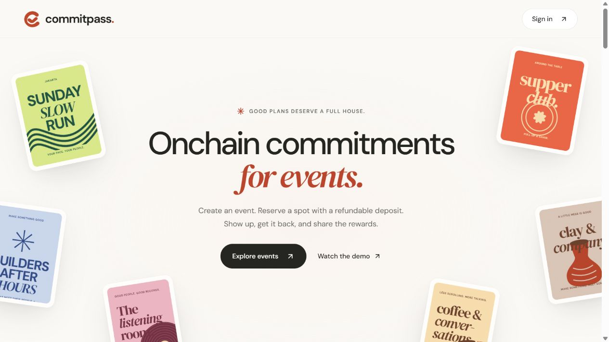
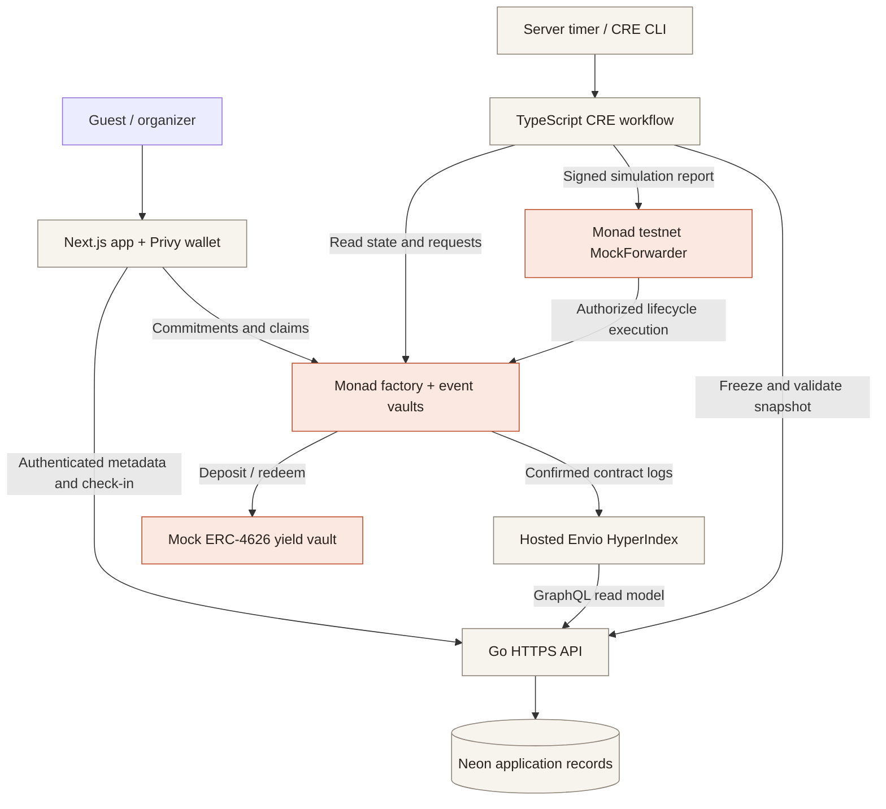

<p align="center"></p>
<h1 align="center">CommitPass</h1>
<p align="center"><strong>Commit to show up. Get rewarded when you do.</strong></p>
<p align="center">Refundable USDC commitments for events on Monad.</p>
<p align="center">
  <a href="https://commitpass-event.vercel.app/">Try the app</a> ·
  <a href="https://www.youtube.com/watch?v=p8Wsvpcy7ZU">Watch the product demo</a> ·
  <a href="https://sama-3.gitbook.io/commitpass-docs/documentation/">Read the docs</a> ·
  <a href="docs/JUDGES.md">Judge's guide</a>
</p>



_Live testnet application. Event posters in the landing illustration demonstrate the design; they are not customer or attendance claims._

## A reservation should mean something

Reserving a free workshop takes seconds. Showing up takes commitment. When guests reserve limited seats and never arrive, hosts face empty rooms, wasted preparation, and a waitlist that could have used those spots.

CommitPass connects a familiar event experience to a small, refundable USDC commitment. A guest reserves, receives a QR pass, checks in, and claims their return after settlement. Hosts set the terms before registration opens. The event contract applies those terms to the final attendance record.

The initial audience is organizers of free, capacity-limited Web3 workshops and community meetups. Informal review feedback and the builder's observations motivate the product; an independent pilot and measured no-show reduction are future validation work.

## Watch, try, inspect

| Resource                                                                    | What it shows                                                            |
| --------------------------------------------------------------------------- | ------------------------------------------------------------------------ |
| [Live app](https://commitpass-event.vercel.app/discover)                    | Event discovery and the participant/organizer workspace on Monad testnet |
| [Product demo · 2:23](https://www.youtube.com/watch?v=p8Wsvpcy7ZU)          | Working create → reserve → QR check-in → settlement → claim flow         |
| [Pitch · 1:59](https://www.youtube.com/watch?v=63YxHvnsKsY)                 | Problem, solution, product story, and direction                          |
| [Chainlink CRE demo · 1:56](https://www.youtube.com/watch?v=NJs1KMFsMWQ)    | CRE CLI simulation and public testnet lifecycle execution                |
| [Product advertisement · 0:30](https://www.youtube.com/watch?v=X1fK7IrGbho) | A short introduction to CommitPass                                       |
| [GitBook](https://sama-3.gitbook.io/commitpass-docs/documentation/)         | Product guides, technical design, deployments, and roadmap               |
| [Evidence guide](docs/EVIDENCE.md)                                          | Transaction links, decoded receipts, accounting, and proof boundaries    |

## How it works

1. **Create an event.** The host chooses capacity, a fixed USDC commitment, registration deadline, start time, and settlement time. Each event gets its own vault.
2. **Reserve a spot.** Guests sign in with email or Google through Privy and confirm their commitment with an embedded wallet.
3. **Start the event.** An organizer request or the scheduled time makes the start eligible. CRE reads the contract and moves pooled commitments into the configured ERC-4626 yield source.
4. **Check in.** The organizer scans the guest's QR pass. The authenticated API records attendance before the contract's cutoff.
5. **Settle.** CRE freezes and validates the attendance snapshot, then delivers a lifecycle report. The vault redeems assets and fixes each claim allocation.
6. **Claim the return.** Guests claim through the app. Envio indexes confirmed transactions for event pages, activity, and personal profiles.

### Where the money goes

| Outcome                          | Distribution                                                                                                                                                                             |
| -------------------------------- | ---------------------------------------------------------------------------------------------------------------------------------------------------------------------------------------- |
| Normal settlement with attendees | Attendees recover their commitments, share half of no-show principal, and receive all recovered surplus. CommitPass receives the other half of no-show principal. No-shows receive zero. |
| Valid zero-attendance settlement | All depositors receive their principal plus their allocated share of recovered surplus; platform revenue is zero.                                                                        |
| Host cancellation before start   | All depositors can claim their original commitment; platform revenue is zero.                                                                                                            |

**Illustrative example:** two guests each commit 5 USDC; one attends and one does not. With no surplus, the attendee is allocated 7.5 USDC and CommitPass receives 2.5 USDC. This explains the policy; it is not a reported customer result. Gas is separate. Exact rounding, cancellation conditions, and liquidity limitations are defined in the [settlement policy](contracts/SETTLEMENT.md).

The live demo uses a **mock ERC-4626 yield vault**. It exercises deposit and redemption; organic Morpho yield is not part of the public testnet evidence.

## Why Monad

Each event needs affordable reservations, lifecycle transactions, and individual claims. Monad's EVM environment lets CommitPass combine Solidity vaults, USDC, embedded wallets, and an ERC-4626 interface in one application. Public contract state makes commitments and payout rules inspectable; the organizer remains responsible for attesting attendance.

## Architecture and data ownership



| Layer                        | Stores or controls                                                                          | Authority                                                                     |
| ---------------------------- | ------------------------------------------------------------------------------------------- | ----------------------------------------------------------------------------- |
| **Onchain · Monad**          | Event terms, USDC deposits, lifecycle state, allocations, claims, and treasury payments     | Contracts enforce financial rules and timing                                  |
| **Offchain · Neon / Go API** | Event descriptions, account links, organizer check-ins, and frozen attendance snapshots     | Authenticated app writes; host-attested attendance                            |
| **Derived · Envio Cloud**    | Event discovery, participant positions, activity, and profile aggregates from contract logs | A reorg-aware read model; current contract state determines claim eligibility |

Frontend hosting is Vercel. The Go API and recurring CRE CLI broadcast simulation run on a server. The active public indexer is hosted Envio Cloud. [Full architecture](docs/gitbook/technical/architecture.md) · [Data storage](docs/gitbook/technical/data-storage.md)

## Sponsor integrations that drive the product

| Integration          | Role in the working flow                                                                                                                                         | Start reading here                                                                                                                                     |
| -------------------- | ---------------------------------------------------------------------------------------------------------------------------------------------------------------- | ------------------------------------------------------------------------------------------------------------------------------------------------------ |
| **Privy**            | Email/Google onboarding, embedded EVM wallets, and in-app signing for reservations and claims; the backend derives current linked wallets from verified identity | [Web authentication](apps/web/src/components/auth/) · [Server verification](api/internal/auth/privy.go)                                                |
| **Envio HyperIndex** | Discovers factory-created vaults and indexes deposits, lifecycle transitions, exact allocations, and paid claims; powers event/activity/profile views            | [Event handlers](indexer/src/handlers/commitpass.ts) · [Hosted API reader](api/internal/indexed/hosted.go)                                             |
| **Chainlink CRE**    | Cron and EVM log triggers share a read → decide → write flow; authenticated HTTP snapshots connect host attendance to onchain settlement                         | [Workflow](cre/commitpass/workflow.ts) · [Snapshot validation](cre/commitpass/attendance.ts) · [CRE demo](https://www.youtube.com/watch?v=NJs1KMFsMWQ) |

**Execution scope:** the live MVP uses authenticated CRE CLI simulation with broadcast and a chain/vault-bound signed receiver. It is not a deployed Workflow DON. Guests provide testnet USDC for commitments. The web app can request Privy gas sponsorship for embedded wallets on public Monad testnet; local Anvil and external organizer wallets use direct gas payment. [Configuration and acceptance scope](apps/web/README.md#testnet-gas-sponsorship).

## Public execution evidence

The latest recorded workshop completed the one-attendee, **1 USDC** flow on Monad testnet. Public receipts were read again on 11 October 2026; final allocation and claimed principal are both **1,000,000 raw units**, with zero no-show revenue and zero surplus.

| Step              | Public transaction                                                                                                               |
| ----------------- | -------------------------------------------------------------------------------------------------------------------------------- |
| Create event      | [Factory creation receipt](https://testnet.monadscan.com/tx/0x83715de1dd21bee9746e6e6e6ffb7c549f5de4ae06e0b771e86dc8edc57f6f59)  |
| Commit 1 USDC     | [Deposit receipt](https://testnet.monadscan.com/tx/0xa01dfdf5d50319d6eb4767679127c702c44f65702c83dddb03a1ae6b2dabd15f)           |
| CRE starts event  | [Start report execution](https://testnet.monadscan.com/tx/0x5173c20e647b857606a1b3e3adb6c344cb61812fc3f1ca6cd5ec97f77f3e7041)    |
| CRE settles event | [Settlement and allocation](https://testnet.monadscan.com/tx/0x363f9a7c9a44d0c50edeb8f0a9c62696c3a7bd7256d7e652e3cd25fdd874efb0) |
| Guest claims      | [Paid claim receipt](https://testnet.monadscan.com/tx/0x012226c9cd17b11158ebf88210cc0fe47937b80a1d12018d93a7536d179b2c81)        |

[Decoded receipts and block-pinned state](docs/evidence/monad-workshop-2026-10-11.json) · [Indexed public activity](https://commitpass-api.endpx.cloud/v1/events/0xded18dab5d35b2ca9fecb2b4a7f0f127c07f939b/activity) · [Evidence scope and local scenarios](docs/EVIDENCE.md)

The active addresses and deployment receipts are in the [canonical manifest](packages/shared/src/deployments/monad-testnet.json). Historical evidence keeps its original deployment identifiers.

## Explore the source

```text
apps/web/              Next.js participant and organizer application
api/                   Go authentication, metadata, attendance, and indexed reads
contracts/             Solidity factory, event vaults, receiver, and policy
cre/                   TypeScript CRE workflow and isolated local fixtures
indexer/               Envio configuration, schema, ABI snapshots, and handlers
packages/shared/       Canonical ABIs, deployment manifest, TS/Go shared data
docs/                  Judge guide, evidence, development guide, GitBook source
```

Applications depend on shared packages; shared packages do not import application code. Go modules are connected by `go.work`. Generated output, credentials, private operational scripts, and raw media deliverables stay outside public source.

### Run locally

Use Node.js 24 (`.node-version`), pnpm 10.21, and Go 1.25+. Solidity and CRE lifecycle work also require Foundry, Bun, and a logged-in CRE CLI.

```sh
git clone --recurse-submodules https://github.com/EndPx/commitpass.git
cd commitpass
pnpm install --frozen-lockfile
# Configure module-owned environment files before starting connected services.
pnpm dev
```

Web: `http://localhost:3000` · API: `http://localhost:8080`. External Privy, Neon, and indexer configuration is required for the connected product. `pnpm dev` does not provision those services. [Development and configuration](docs/DEVELOPMENT.md) · [Interactive Anvil app](cre/local/INTERACTIVE.md) · [CRE fixture](cre/local/README.md)

## Next milestones

| Stage                  | Deliverable                                                                                                                                          | Status                       |
| ---------------------- | ---------------------------------------------------------------------------------------------------------------------------------------------------- | ---------------------------- |
| Hackathon MVP          | Connected testnet app, QR check-in, indexed activity, CRE broadcast lifecycle, and paid claims                                                       | Demonstrated; evidence above |
| Organizer discovery    | Interviews with capacity-limited workshop hosts; collect actual RSVP/attendance baselines and funding-friction feedback                              | Planned                      |
| Pilot                  | A small community event with independent participants; measure reservation completion, attendance, claims, and host repeat intent                    | Planned                      |
| Production preparation | Attendance correction/dispute policy, loss/liquidity recovery, security review, production workflow execution, and compatible live yield integration | Pending                      |

Initial acquisition is organizer-led: community hosts bring attendees through event links. Informal feedback is an early signal, not adoption. The implemented revenue policy is half of forfeited no-show principal in normal settlement; willingness to accept that fee remains to be validated. [Roadmap and go-to-market](docs/gitbook/mission/roadmap.md)

## Builder and acknowledgments

Built by **Muhammad Meidy Noor Al Barry (Albary / EndPx)**, solo fullstack developer. [X · @endpx_](https://x.com/endpx_)

CommitPass adopts the event commitment mechanism from [ATFI contracts](https://github.com/ATFi-Event/smart-contract/tree/1c57d35b80bb67afc04ee3d9a26292721695aed5) and references [ATFI backend](https://github.com/ATFi-Event/backend/tree/3413119726c2fd3038253020f940378c192ae2b6). [ShowOrSow](https://github.com/EndPx/ShowOrSow/tree/8fbe3f04a05eb19eca10710173057f65d9aadf84/web) informed the frontend flow. This repository adapts identity, indexing, automation, and settlement accounting for CommitPass.
