# Links

GitHub Repository: [https://github.com/EndPx/commitpass](https://github.com/EndPx/commitpass)

Docs: [https://sama-3.gitbook.io/commitpass-docs](https://sama-3.gitbook.io/commitpass-docs)

Website: [https://commitpass-event.vercel.app](https://commitpass-event.vercel.app)

Live App: [https://commitpass-event.vercel.app/discover](https://commitpass-event.vercel.app/discover)

## Pitch video

The story behind CommitPass: the no-show problem, refundable commitments, and our direction.



## Pitch deck

Browse the 12 slides, including Why Monad, the product flow, business model, roadmap, and team.



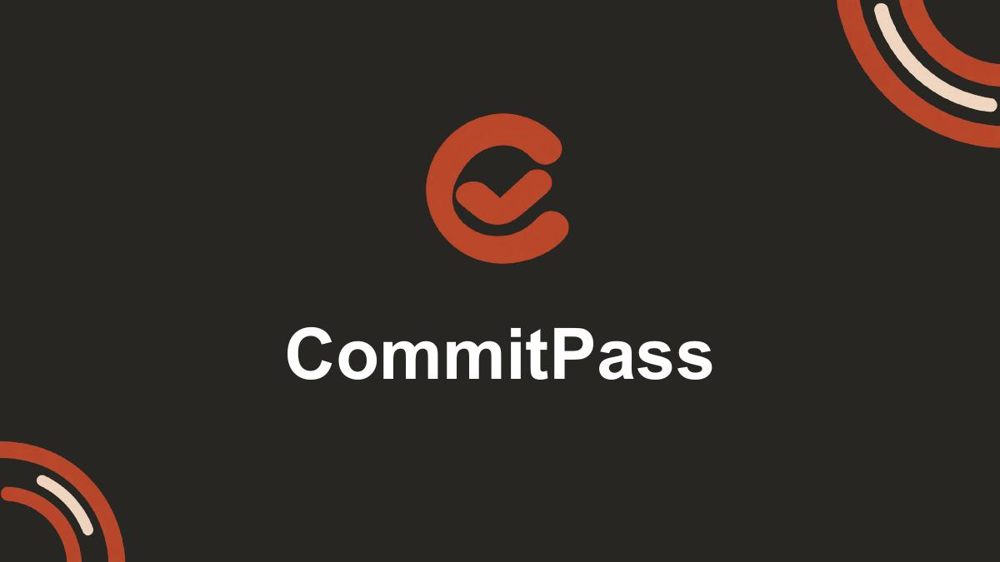



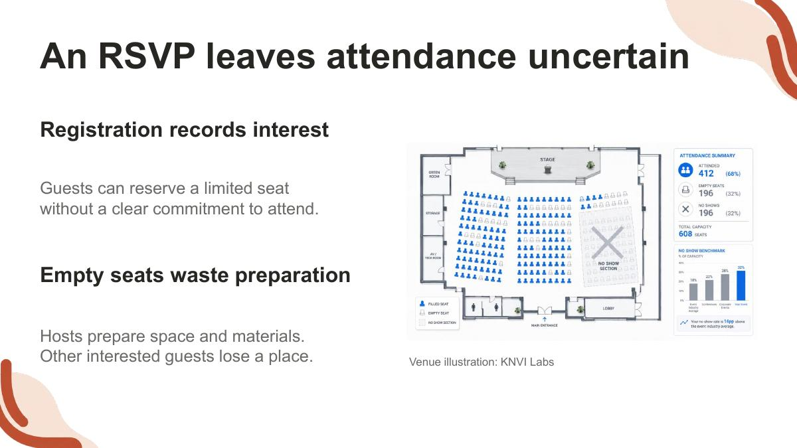



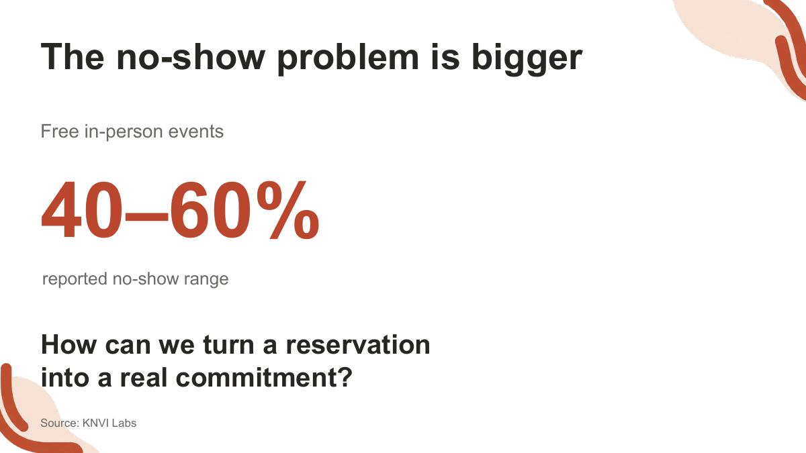



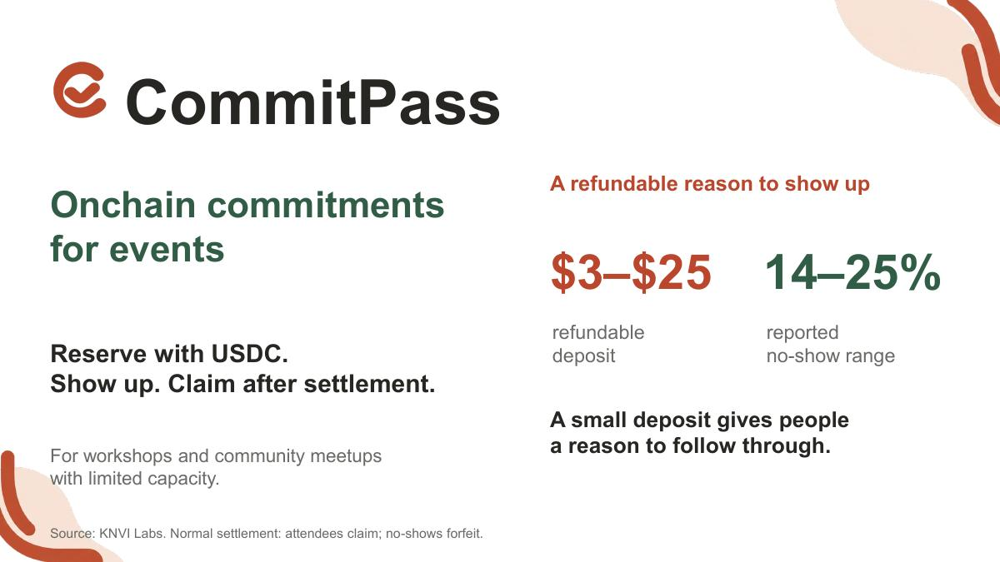



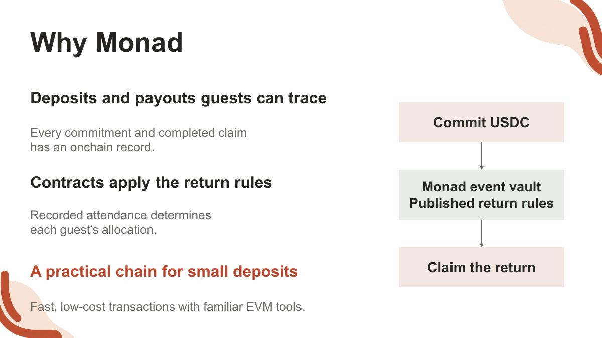



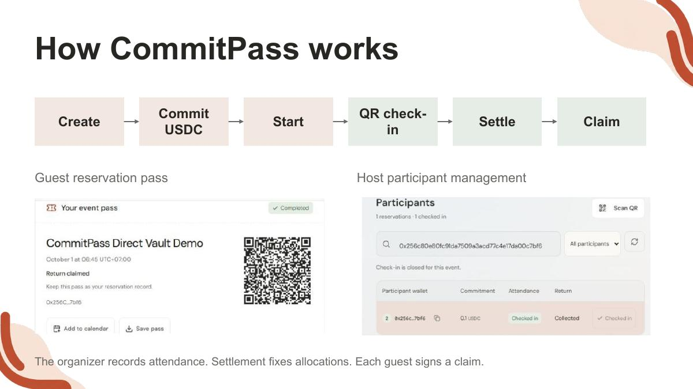



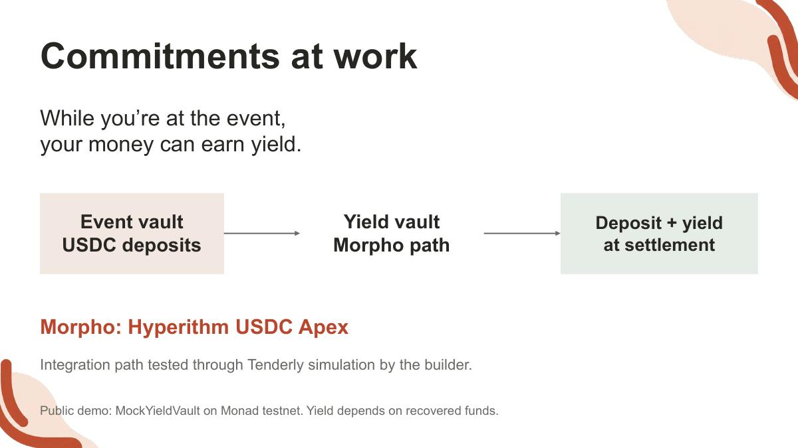



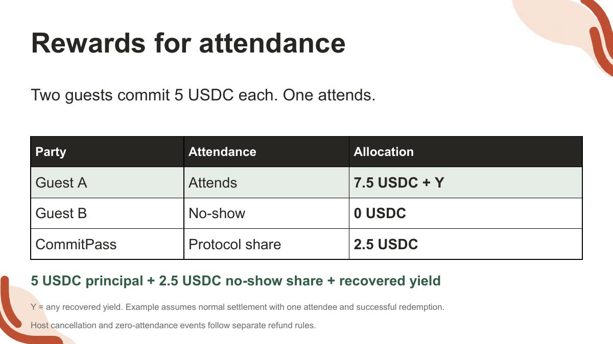



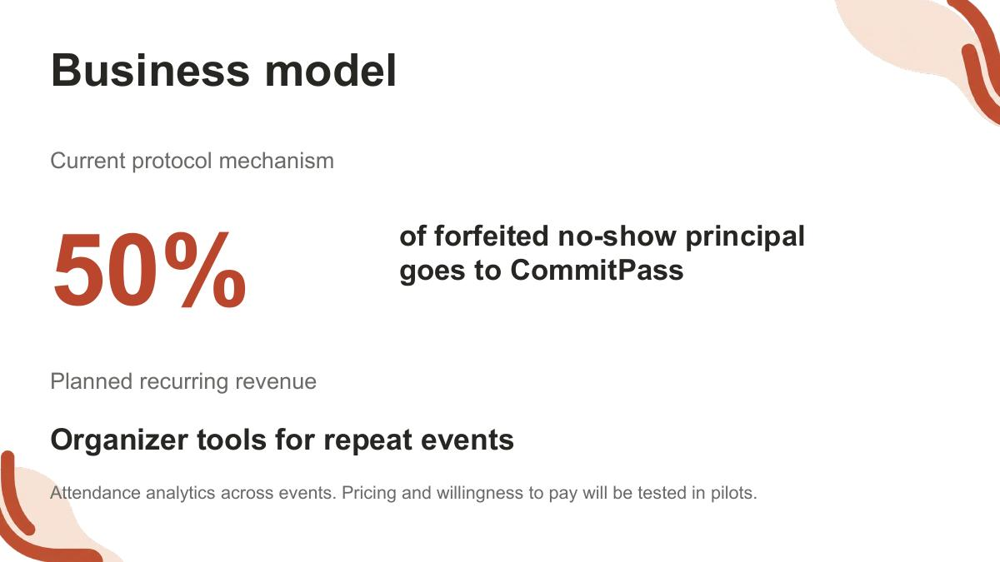



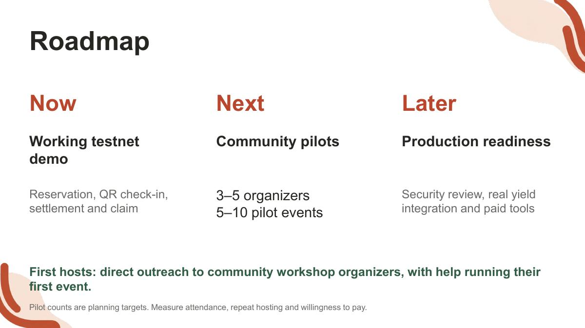



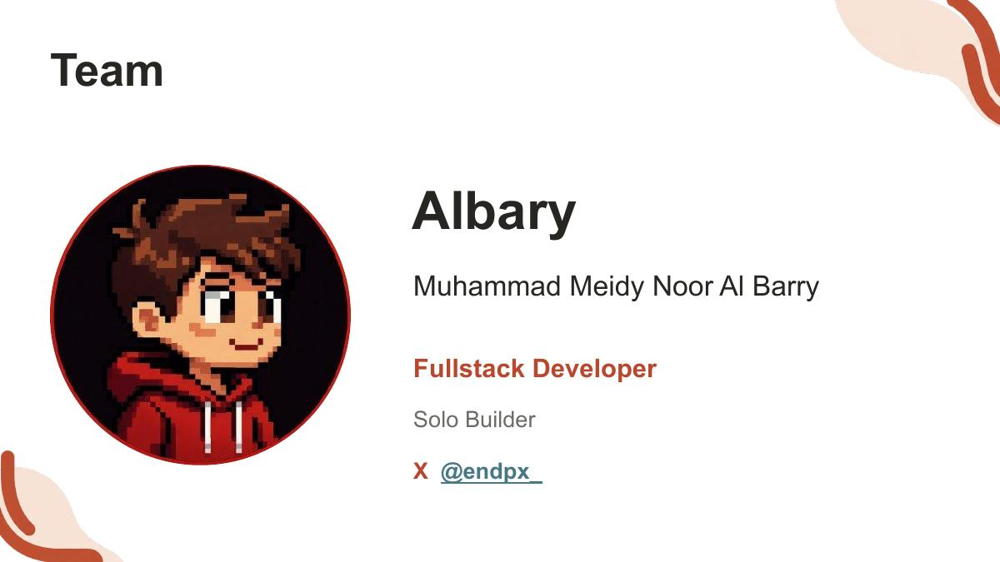



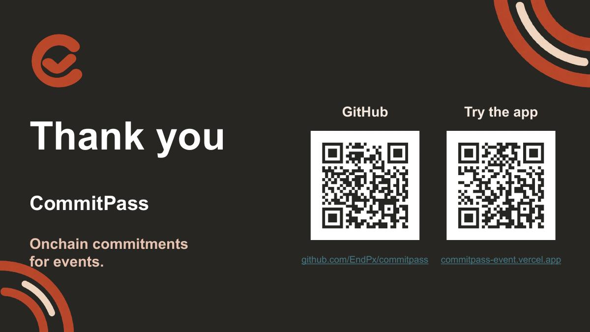




Download the pitch deck (PDF)



Download the editable pitch deck (PowerPoint)


## Technical demo

The working application from an organizer creating an event to a guest claiming their return.



## Chainlink CRE demo

CRE CLI simulation and lifecycle broadcasts for the live Monad testnet MVP.



## Product advertisement

A short introduction to CommitPass.


